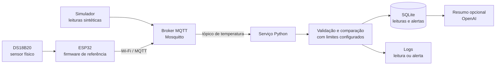

# MediSUS IoT

### Protótipo acadêmico de monitoramento demonstrativo de temperatura

Este projeto demonstra como uma leitura de temperatura pode sair de um sensor, passar por MQTT e ser validada, registrada e sinalizada por um serviço. O cenário de referência é o armazenamento de medicamentos em uma Unidade Básica de Saúde (UBS).

**O projeto funciona sem placa ou sensor:** um simulador publica leituras sintéticas para que qualquer pessoa possa executar e observar o fluxo completo usando Docker Compose.

> [!IMPORTANT]
> Este é um protótipo acadêmico. Os limites padrão de **2 °C a 8 °C são apenas parâmetros de demonstração** — não são recomendação médica, regra universal ou orientação regulatória. Em qualquer aplicação real, os limites devem vir de uma fonte oficial aplicável ao produto específico. O sketch e o circuito não foram validados em hardware.

## Equipe

| Integrante | RM |
|---|---:|
| Natália Cristina | RM564099 |
| Nickolas Davi | RM564105 |
| Rodrigo Silva | RM565162 |
| Samara Vilela | RM566133 |
| Otávio Ferreira | RM565960 |

## Baixar o código no Windows

Abra o PowerShell e clone a branch que contém este protótipo:

```powershell
git clone --branch rodrigocsilvaa-iot-prototype https://github.com/Rodrigocsilvaa/MediSUS-IoT.git
Set-Location MediSUS-IoT
```

O código também pode ser consultado diretamente na [página do projeto no GitHub](https://github.com/Rodrigocsilvaa/MediSUS-IoT/tree/rodrigocsilvaa-iot-prototype).

## Abrir e executar pelo VS Code

1. Instale o Visual Studio Code e o Docker Desktop. O Docker Desktop precisa estar aberto para iniciar os contêineres.
2. No PowerShell, entre na pasta do projeto e abra-a no VS Code:

   ```powershell
   Set-Location MediSUS-IoT
   code .
   ```

   Se o comando `code` não estiver disponível, abra o VS Code e escolha **Arquivo > Abrir Pasta...**; selecione a pasta `MediSUS-IoT`.
3. No VS Code, abra **Terminal > Novo Terminal**. O terminal integrado deve estar na pasta do projeto.
4. Execute os comandos da seção [Início rápido](#início-rápido-execute-a-demonstração). Os logs e o resultado do simulador aparecerão nesse terminal.

Não é necessária uma extensão do VS Code para rodar a demonstração com Docker Compose. Para editar e executar os testes Python localmente, instale Python 3.10 ou superior.

## Navegação

- [O que o projeto demonstra](#o-que-o-projeto-demonstra)
- [Como os componentes se conectam](#como-os-componentes-se-conectam)
- [Abrir e executar pelo VS Code](#abrir-e-executar-pelo-vs-code)
- [Executar a demonstração](#início-rápido-execute-a-demonstração)
- [Gerar um resumo com IA](#gerar-um-resumo-com-ia)
- [Executar os testes](#executar-os-testes)
- [Evidências e avaliação](#evidências-e-avaliação)
- [Integração de referência ESP32 e DS18B20](#integração-de-referência-esp32-e-ds18b20)
- [Formato das mensagens](#formato-das-mensagens)
- [Limitações e uso responsável](#limitações-e-uso-responsável)

## O que o projeto demonstra

- Um **ESP32 com sensor DS18B20** pode publicar uma leitura de temperatura em uma mensagem MQTT.
- Um **broker Mosquitto** recebe e distribui as mensagens.
- Um **serviço Python** valida cada leitura, compara a temperatura com os limites configurados e grava os dados em SQLite.
- Quando a temperatura fica fora do intervalo configurado, o serviço marca a leitura como alerta e a destaca nos logs.
- Um **simulador** substitui o sensor físico na demonstração e envia apenas dados sintéticos.
- Um **resumidor com IA generativa**, executado sob demanda, cria um resumo em português das últimas leituras e dos alertas registrados.

O alerta é demonstrativo: aparece nos logs e no registro SQLite. Não é uma notificação para uma pessoa nem uma garantia de resposta a uma situação real. A IA resume os alertas já calculados pelas regras do serviço; ela não define limites nem decide se um medicamento está adequado.

## Como os componentes se conectam



Na demonstração rápida, o simulador ocupa o lugar do sensor e do ESP32. O firmware é uma referência de integração futura.

## O que você precisa

Para executar a demonstração:

- Docker Desktop instalado e **em execução**.
- Docker Compose v2 (incluído nas versões atuais do Docker Desktop).

Para executar os testes localmente, também é necessário Python 3.10 ou superior. A conexão do ESP32 é opcional e exige placa, sensor e Arduino IDE ou PlatformIO.

O resumo com IA é opcional e requer uma chave de API da OpenAI, acesso à internet e uma conta com acesso à API. O uso da API pode gerar cobrança conforme a conta e o modelo. A chave não está incluída no projeto.

## Início rápido: execute a demonstração

Abra um terminal na pasta do repositório. Inicie o broker e o serviço:

```powershell
docker compose up -d --build mosquitto monitor
```

Quando os serviços estiverem iniciados, execute o simulador:

```powershell
docker compose --profile demo run --rm simulator
```

Veja o resultado:

```powershell
docker compose logs --no-color monitor
```

Também é possível verificar o estado dos contêineres:

```powershell
docker compose ps
```

### Resultado esperado

O simulador envia quatro leituras **sintéticas**: `4.5 °C`, `5.2 °C`, `8.3 °C` e `3.8 °C`. Com os limites demonstrativos padrão de `2 °C` e `8 °C`:

| Leitura sintética | Resultado esperado |
|---:|---|
| 4.5 °C | Dentro do intervalo; registrada sem alerta |
| 5.2 °C | Dentro do intervalo; registrada sem alerta |
| 8.3 °C | Acima do limite demonstrativo; registrada com alerta |
| 3.8 °C | Dentro do intervalo; registrada sem alerta |

No log do serviço, cada leitura válida aparece como JSON. A leitura `8.3 °C` aparece no nível `WARNING` com `"alert": true`; as outras aparecem como `INFO` com `"alert": false`.

Para consultar também as linhas guardadas no SQLite dentro do contêiner:

```powershell
docker compose exec monitor python -c "import sqlite3; c=sqlite3.connect('/data/readings.sqlite3'); [print(r) for r in c.execute('SELECT device_id, temperature_c, timestamp, alert FROM readings ORDER BY id')]"
```

### Gerar um resumo com IA

Depois de executar o simulador, você pode pedir à IA que resuma as últimas leituras. A integração usa a API da OpenAI e só é iniciada quando você executa este passo. Ela envia no máximo 20 leituras, contendo temperatura, horário e o alerta calculado; não envia o identificador do sensor.

1. Crie um arquivo `.env` na pasta do projeto, por exemplo abrindo-o no Bloco de Notas:

   ```powershell
   notepad .env
   ```

2. Coloque nele a sua chave da API e salve:

   ```text
   OPENAI_API_KEY=sua-chave-da-api
   OPENAI_MODEL=gpt-4.1-mini
   ```

3. Execute o resumidor:

   ```powershell
   docker compose --profile ai run --rm ai-summary
   ```

O arquivo `.env` é ignorado pelo Git. **Não compartilhe nem envie esse arquivo ao repositório.** Use somente as leituras sintéticas da demonstração: não envie dados de pacientes, funcionários ou medições reais a um serviço externo. A resposta gerada pode conter erros; ela é apenas um resumo informativo e não deve orientar decisões clínicas. A classificação de alertas continua sendo feita pelo código, com limites demonstrativos.

### Parar a demonstração

Para parar os serviços sem apagar os dados:

```powershell
docker compose down
```

As leituras ficam no volume Docker `medisus-iot-data`. Para parar os serviços **e apagar esse volume**, use:

```powershell
docker compose down --volumes
```

## Executar os testes

Os testes cobrem a validação de payloads, a interpretação de limites, o registro de leituras e a integração com a IA usando uma resposta simulada. Eles usam a biblioteca padrão do Python, não precisam de um broker MQTT e **não fazem chamadas externas à API**.

O GitHub Actions também executa automaticamente essa suíte ao enviar alterações para a branch ou abrir um pull request. O workflow está em `.github/workflows/tests.yml`. Na última execução registrada, os **12 testes passaram no runner Windows** ([ver execução](https://github.com/Rodrigocsilvaa/MediSUS-IoT/actions/runs/44631287322)).

**Windows PowerShell:**

```powershell
$env:PYTHONPATH = "src"
python -m unittest discover -s tests -v
```

## Evidências e avaliação

Os logs, capturas de tela, casos de teste, resultados e limitações estão em [`evidence/EVIDENCIAS.md`](evidence/EVIDENCIAS.md). As temperaturas mostradas são sintéticas. A documentação separa os testes locais realizados das etapas que ainda dependem de execução via Docker Compose e de uma chave válida para testar a API real de IA.

## Configuração da demonstração

Os valores demonstrativos estão declarados no serviço `monitor` em `docker-compose.yml`:

```yaml
MIN_TEMP_C: "2"
MAX_TEMP_C: "8"
```

Para experimentar outros valores, altere essas variáveis e recrie o serviço:

```powershell
docker compose up -d --force-recreate monitor
```

O serviço rejeita uma configuração em que o limite mínimo não seja menor que o máximo. Os limites alterados continuam sendo apenas valores de teste; não os use para orientar o armazenamento real de medicamentos.

## Integração de referência: ESP32 e DS18B20

O sketch está em `firmware/esp32_ds18b20/esp32_ds18b20.ino`. Ele usa as bibliotecas `PubSubClient`, `OneWire` e `DallasTemperature`, além das bibliotecas de Wi-Fi e horário do ESP32.

Ligação de referência:

| DS18B20 | ESP32 |
|---|---|
| VDD | 3V3 |
| GND | GND |
| DATA | GPIO 4 |

Use um resistor pull-up de **4,7 kΩ** entre DATA e 3V3. Confirme a pinagem da placa e do sensor antes de montar o circuito.

Antes de carregar o sketch:

1. Instale as bibliotecas listadas no comentário inicial do arquivo.
2. Preencha `WIFI_SSID`, `WIFI_PASSWORD` e `MQTT_SERVER` no dispositivo. Os valores existentes são exemplos/placeholders, não credenciais reais.
3. Configure `MQTT_SERVER` com o endereço de rede do computador que executa o broker. No ESP32, `localhost` apontaria para o próprio dispositivo, não para o computador.
4. Conecte o ESP32 e o computador à mesma rede acessível e inicie o broker.

O sketch tenta sincronizar o horário por NTP para publicar o campo `timestamp` no formato esperado pelo serviço. O broker local de demonstração não usa TLS nem autenticação: mantenha-o em uma rede confiável e não exponha a porta `1883` à internet.

**Atenção:** o firmware e a ligação são documentação de referência, não uma integração verificada. O fluxo recomendado para apresentação é usar o simulador.

## Formato das mensagens

O serviço assina o tópico `medisus/ubs/+/temperatura`. Uma mensagem válida tem este formato:

```json
{
  "device_id": "simulador-ubs-demo",
  "temperature_c": 8.3,
  "timestamp": "2026-01-01T12:00:00Z"
}
```

O serviço verifica se:

- o payload é um objeto JSON;
- `device_id` é um identificador de texto não vazio;
- `temperature_c` é um número finito dentro da faixa do DS18B20 (-55 °C a 125 °C);
- `timestamp` é uma data ISO 8601 com fuso horário.

Payloads inválidos são rejeitados e descritos nos logs; não são gravados como leituras válidas.

## Estrutura do repositório

```text
.
├── docker-compose.yml            # Broker, serviço, simulador e perfil de IA
├── Dockerfile                    # Imagem do serviço Python
├── mosquitto/mosquitto.conf      # Configuração local do broker MQTT
├── .github/workflows/tests.yml   # Execução automatizada dos testes no GitHub
├── evidence/                     # Logs, capturas e relatório de avaliação
├── src/medisus_iot/
│   ├── monitor.py                # Assinatura MQTT, alertas e coordenação
│   ├── readings.py               # Validação e avaliação dos limites
│   ├── simulator.py              # Publicação de dados sintéticos
│   ├── ai_summary.py             # Resumo generativo sob demanda
│   └── storage.py                # Persistência SQLite
├── firmware/esp32_ds18b20/       # Sketch de referência para ESP32
└── tests/
    ├── test_ai_summary.py        # Testes da integração de IA sem chamada externa
    ├── test_readings.py          # Testes de validação e alertas
    └── test_storage.py           # Testes da persistência SQLite
```

## Evidências para apresentar

Uma apresentação pode mostrar:

1. `docker compose ps`, para identificar os serviços em execução.
2. A execução do simulador, que imprime os payloads sintéticos publicados.
3. `docker compose logs --no-color monitor`, para mostrar leituras válidas e o alerta demonstrativo.
4. A consulta SQLite acima, para mostrar os registros persistidos.
5. O resumo gerado pela IA, se a integração opcional for executada; não mostre a chave da API.
6. Se o protótipo físico for montado, uma foto da ligação, identificada como **evidência de hardware**.

Deixe claro quais resultados vieram do simulador e quais, se houver, vieram de medições físicas. Não apresente leituras sintéticas como medições reais.

## Limitações e uso responsável

- O projeto demonstra fluxo de software; não realiza calibração nem avalia a instalação do sensor.
- SQLite e logs são adequados para demonstração, não para garantir operação, retenção ou resposta em produção.
- O broker de demonstração não tem autenticação nem criptografia de transporte.
- O resumo usa uma API externa e pode apresentar erros; não é uma avaliação clínica.
- Não há painel visual, notificações externas nem lógica de contingência.
- Temperaturas aceitáveis dependem do produto e devem ser determinadas por documentação oficial aplicável.
- Este protótipo não substitui equipamentos, processos ou validações exigidos para armazenamento real.
